  

### about

B.Tech CSE student at **IIIT Kottayam**. I work across ML and full stack, and like building things end to end. Most of what I know, I picked up by building and breaking things. Open source contributor, always learning.

### tools

 

 

 

### say hello

 
